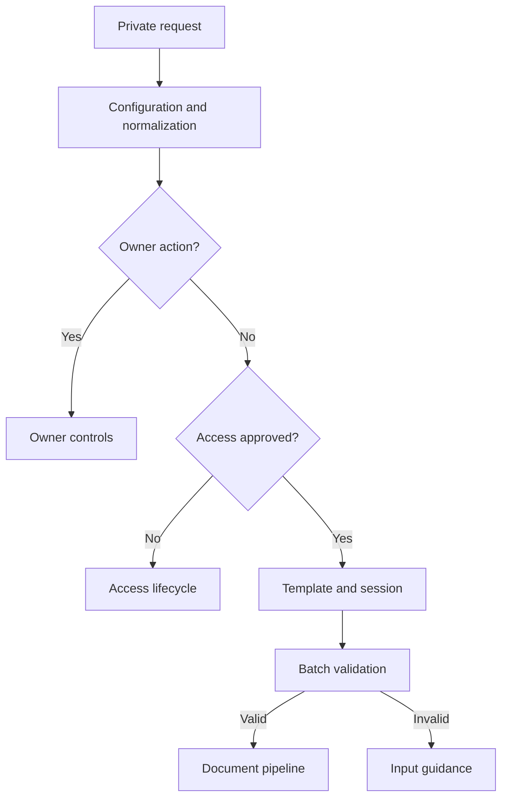
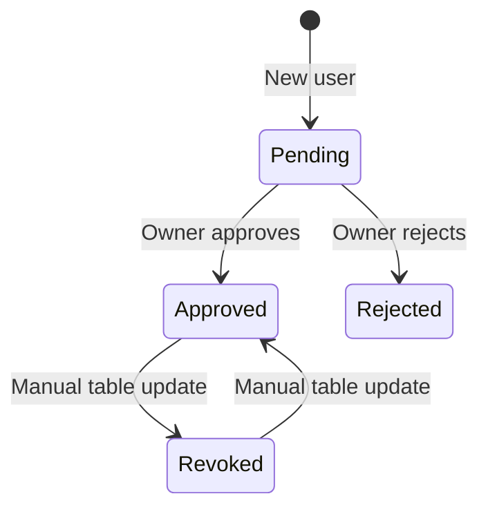

# Architecture and operating boundaries

## Routing

The document pipeline copies the selected template, replaces fields, reads document structure, applies hyperlinks, exports the PDF, delivers it, deletes the temporary copy, and sends one completion notice. A batch is validated completely before any document copy is created. Each output item retains n8n item pairing for correct per-record field and link resolution.

## Access lifecycle

Owner actions require the configured sender ID and a recognized command. Approval/rejection updates additionally require a pending target, a non-owner role, and a target ID different from the owner. Listing pending requests never sends an approval notice. Approving an eligible request branches to the user notice and owner confirmation.

The owner menu implements approval, rejection, pending-request listing and approved-user listing. Revocation/reactivation are **manual access-table operations**, not implemented buttons. Unknown statuses fail closed. Access is checked at request entry; an already-running batch is not canceled by a later status change.

## Runtime data

The access table stores user identity/status. The session table stores chat/template selection. Record fields and contact emails flow through execution memory, copied Google documents, and PDF delivery. This project does not anonymize data entered into a deployed instance. See [PRIVACY.md](PRIVACY.md).

## Failure and scale boundaries

- Validation errors use a separate error output and a generic message.
- Missing sessions are sent to input guidance.
- Other provider errors stop their path. There is no global error workflow or guaranteed compensation.
- If PDF delivery or another step fails, a temporary copy may remain. Review failed runs and clean up only confirmed temporary files.
- Copy retries may create duplicates after ambiguous provider responses. There is no idempotency key or distributed transaction.
- One completion notice is sent after successful cleanup items reach the Limit node. This is not a durable per-record audit ledger.
- There is no rate limiting or pagination of owner lists. Large lists may hit Telegram rate limits.
- Inline callbacks are not explicitly acknowledged; the Telegram client may briefly retain its loading indicator.
- The data-table model is suited to a small deployment. Concurrent updates can require stronger uniqueness and locking.
- The public workflow has offline validation, not an executed end-to-end provider certification.

These limits are explicit extension points, not claims of enterprise-scale reliability.
