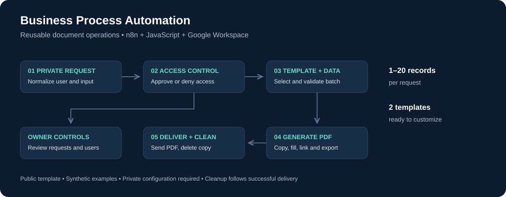

# Business Process Automation

### Controlled access. Structured requests. Ready-to-use documents.

An **n8n document operations workflow** that turns structured requests into personalized PDF files. It combines owner-managed access, reusable Google Docs templates, batch validation, document delivery, and temporary-file cleanup.

Built and adapted by **Maged Bin Laswad** · [GitHub](https://github.com/magedbinlaswad)



> **Public template:** all examples are synthetic. Credentials, account IDs, private resource links, execution data, and organization-specific messages are excluded. The workflow imports inactive and requires private configuration.

## The business problem

Repeatedly copying a document, replacing fields, exporting a PDF, and delivering it introduces manual effort and inconsistent formatting. This project separates request intake, access decisions, and document generation so the same process can support different business forms.

## What it does

- Accepts requests through a private Telegram conversation.
- Registers new users for owner approval or rejection.
- Checks access before allowing document creation.
- Stores a selected template in an n8n session table.
- Validates batches of **1–20 records** with one shared contact email.
- Replaces four fields in a copied Google document and adds clickable contact/record links.
- Exports and delivers PDFs, then deletes the temporary copies on successful runs.
- Provides owner menus for pending requests and approved users.

**Stack:** n8n · JavaScript · Telegram Bot API · Google Docs · Google Drive · n8n Data Tables

## Quick start

1. Download [business-process-automation.json](business-process-automation.json).
2. Import it into a new n8n workflow.
3. Follow [SETUP.md](SETUP.md) to create two tables, two templates, and connect your own credentials.
4. Set the five private values and permitted link hosts in **Project Configuration**.
5. Test with a separate test bot and synthetic records before publishing your deployment.

```text
Link: https://example.com/records/REQ-001
Record: REQ-001 | Department: Operations | Reference: CASE-001

Email: demo@example.com
```

## Project files

| File | Purpose |
| --- | --- |
| [business-process-automation.json](business-process-automation.json) | Importable workflow with named nodes and four explanatory notes |
| [SETUP.md](SETUP.md) | Credentials, configuration, tables, and acceptance checklist |
| [TEMPLATES.md](TEMPLATES.md) | Two generic document bodies to copy into Google Docs |
| [ARCHITECTURE.md](ARCHITECTURE.md) | Routing, access lifecycle, and operational boundaries |
| [CUSTOMIZATION.md](CUSTOMIZATION.md) | Adaptation guide for other business processes |
| [PRIVACY.md](PRIVACY.md) | Public-export policy and runtime data handling |
| [sample-request.txt](sample-request.txt) | Synthetic two-record request |
| [sample-update.json](sample-update.json) | Synthetic Telegram update for development |
| [validate.mjs](validate.mjs) | Dependency-free offline checks |

## Validation and scope

Run `node validate.mjs` with Node.js 22 or newer. The checks cover graph references, unconfigured deployment protection, private-chat intake, batch limits, malformed input, link allowlisting, document text ranges, and owner guards.

**12 offline checks pass.** They do not call Telegram, Google, or a live n8n execution engine. Reconnect credentials and complete the integration checklist before real use; no production-readiness or measured time-saving claims are implied.

Current boundaries: access revocation/reactivation are manual table updates; the workflow has no idempotency key, global failure compensation, rate limiting, or guaranteed cleanup after a provider failure. A PDF already delivered remains in the recipient's chat. See [ARCHITECTURE.md](ARCHITECTURE.md).

## Where it can grow

The included Service Confirmation and Internal Request Summary templates demonstrate a reusable pattern. Possible extensions include procurement summaries, service handover documents, and operational letters. These are adaptation ideas, not integrations included in this release.

[العربية](README.ar.md)
